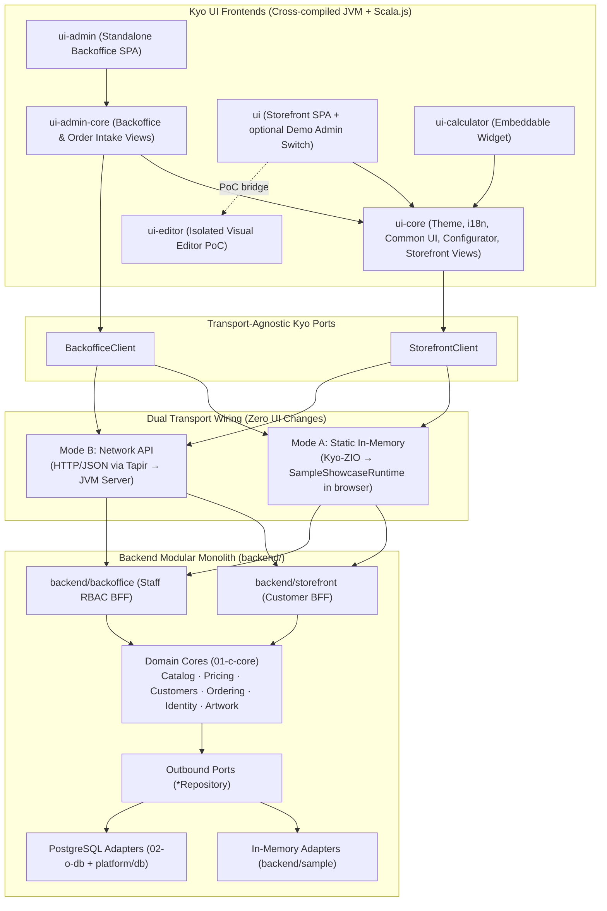
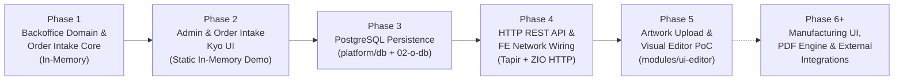

# Platform Roadmap & Architectural Analysis

## 1. Current State & Codebase Audit

The repository already has a strong foundation: **10 cross-compiled (JVM + Scala.js) backend modules** following hexagonal DDD isolation and a **cross-platform Kyo UI storefront + embeddable calculator** decoupled via [`StorefrontClient`](file:///Users/davidlebl/dev/product-builder/modules/ui-core/src/main/scala/mpbuilder/ui/port/StorefrontClient.scala).

| Bounded Context / Module | What Exists Today | Missing for "Order → Intake + Full Management" Milestone |
|---|---|---|
| [`backend/identity`](file:///Users/davidlebl/dev/product-builder/backend/identity/01-c-core/src/main/scala/mpbuilder/identity/IdentityApi.scala) | `Principal.Customer` & `Principal.Employee(roles)`, Password + OTP auth, Sessions | Staff CRUD (create/list/update roles/deactivate employees), RBAC authorization guard helpers |
| [`backend/catalog`](file:///Users/davidlebl/dev/product-builder/backend/catalog/01-c-core/src/main/scala/mpbuilder/catalog/CatalogService.scala) | Read-only catalog queries, canonical `RuleEngine`, imposition, configuration | Admin CRUD for categories, presets, materials, finishes, printing methods, rules, showcase listings & catalog versioning |
| [`backend/pricing`](file:///Users/davidlebl/dev/product-builder/backend/pricing/01-c-core/src/main/scala/mpbuilder/pricing/PricingService.scala) | Quoting, B2B dual pricing, margin analysis, promo evaluation & redemption | Admin CRUD for pricelists, pricing rules, customer agreements, discount/promo codes, cost sheets |
| [`backend/customers`](file:///Users/davidlebl/dev/product-builder/backend/customers/01-c-core/src/main/scala/mpbuilder/customers/CustomerApi.scala) | `register`, `approve`, `suspend`, `changeTier`, `grantPaymentTerms`, lookups | `listCustomers` (filtered/paged), profile/address updates, `addAccountNote`, reactivate/deactivate |
| [`backend/ordering`](file:///Users/davidlebl/dev/product-builder/backend/ordering/01-c-core/src/main/scala/mpbuilder/ordering/OrderingApi.scala) | Cart, checkout options, `placeOrder`, `confirmPayment`, basic status transitions, `listOrdersByCustomer` | **Order Intake queue** (`listOrders` with filters), explicit employee **accept / reject / hold** actions, manual stage transitions with **audit timeline (`OrderStatusHistory`)** & internal staff notes, Admin CRUD for pickup locations / couriers / bank config |
| [`backend/artwork`](file:///Users/davidlebl/dev/product-builder/backend/artwork/01-c-core/src/main/scala/mpbuilder/artwork/ArtworkApi.scala) | Upload, revisions, automated preflight report, operator approve / request changes | `listByOwner`, wiring into `StorefrontFacade` & Backoffice intake review |
| [`backend/storefront`](file:///Users/davidlebl/dev/product-builder/backend/storefront/src/main/scala/mpbuilder/storefront/StorefrontFacade.scala) | Customer-facing BFF (`StorefrontFacade`) | Needs sibling **`backend/backoffice`** BFF enforcing `EmployeeRole` RBAC |
| `backend/platform` & `02-o-db` | Not created yet (blueprint in [scala_3_modulith_boilerplate.md](file:///Users/davidlebl/dev/product-builder/guides/scala_3_modulith_boilerplate.md)) | PostgreSQL pool, migrations, concrete `*Repository` implementations (all 13 repository traits already exist in `01-c-core`!) |
| `modules/ui*` | `ui-core` (JVM+JS), `ui` (Storefront SPA), `ui-calculator` (Widget) | `ui-admin-core` + `ui-admin` (Backoffice SPA), optional `ui-editor` (Visual Editor PoC), HTTP client adapters |

> [!TIP]
> Every backend context **already defines narrow `private[<ctx>] trait *Repository` outbound ports** (13 repository traits in total). That means building all new admin/intake features in-memory first and swapping in PostgreSQL later requires **zero rewrites to domain logic or UI views**.

---

## 2. Target Architecture

### Key Architectural Decisions

1. **Separate `ui-admin-core` module, shared design system**:
   - **Why**: Keeps customer storefront bundles lean in production (customers never download admin code) and enforces a hard compile-time boundary between `StorefrontClient` and `BackofficeClient`.
   - **Best of both worlds for static in-memory demo**: In static demo mode, `modules/ui` can optionally mount the backoffice under `#/admin` sharing the **same** live in-memory `SampleShowcaseRuntime` instance — so you can place an order in the Storefront and immediately switch to Staff Intake to accept and advance it in the same browser session! Meanwhile `modules/ui-admin` builds as an independent SPA for real deployments.
2. **Isolate Visual Editor in `modules/ui-editor`**:
   - Define a minimal bridge contract (`ArtworkDraftBridge`: dimensions + bleed in → design JSON + preview SVG/PNG + `ExtractedFileSpecs` out).
   - Storefront & Order Intake only ever see `ArtworkId` / preview / preflight report — never editor internals. Later, adding server-side PDF/X-4 rendering only adds an export adapter behind the same contract.
3. **In-Memory First, Then Persistence, Then HTTP API** (or **Domain + Admin UI first → Persistence → HTTP API**):
   - Doing **Phases 1–2 (Domain + Backoffice UI in-memory)** *before* DB schemas and HTTP DTOs lets you validate every single admin workflow, order intake state machine, and catalog/pricing editing UX with zero migration churn. Once the domain shapes stabilize, **Phase 3 (PostgreSQL)** and **Phase 4 (HTTP API)** serialize stable, proven models.

---

## 3. Recommended Phased Roadmap

### Phase 1 — Backoffice Domain & Order Intake Core *(In-Memory, JVM + JS)*
**Goal**: Complete all backend business logic required for order intake and platform management, still 100% cross-compiled and runnable in-memory.

1. **Ordering & Order Intake (`backend/ordering`)**:
   - Refine `OrderStatus` for manual intake without manufacturing:
     - `Placed` / `AwaitingPayment` → `PendingIntake` (or `Placed` enters intake directly) → `Accepted` → `InProgress` (manual) → `ReadyForDispatch` → `Dispatched` → `Completed`, plus `OnHold(reason)` and `Cancelled(reason)`.
   - Add immutable **`OrderStatusEvent`** history (`from`, `to`, `actor: OrderActor`, `note`, `occurredAt`) and internal staff notes on `Order`.
   - Extend `OrderService` with:
     - `listOrders(filter: OrderFilter)` (by status, payment status, search query, date range, customer)
     - `acceptOrder(orderId, employeeId, note)`, `putOnHold(orderId, employeeId, reason)`, `resumeOrder(orderId, employeeId)`, `advanceStage(orderId, targetStatus, employeeId, note)`, `addInternalNote(...)`, `confirmPayment(orderId, ref, employeeId)`.
   - Add Admin CRUD on delivery/payment settings (`ShopPickupLocation`, `CourierServiceOption`, `BankAccountConfig`).
2. **Catalog Management (`backend/catalog`)**:
   - Add `CatalogAdminService` (or write methods on `CatalogService` + `CatalogRepository`): CRUD for `ProductCategory`, `ProductPreset`, `Material`, `Finish`, `PrintingMethod`, `CompatibilityRule`, and `ShowcaseListing`, with validation (cannot delete a material referenced by an active preset, rule sanity checks) and automatic `catalogVersion` bump + `CatalogPublished` event.
3. **Pricing Management (`backend/pricing`)**:
   - Add `PricingAdminService`: CRUD for `Pricelist` & `PricingRule`s, `CustomerAgreement`s, `DiscountCode`s (create/activate/deactivate/usage stats), and `CostSheet`s (with live margin simulation via existing `analyzeMargin`).
4. **Customer & Staff Management (`backend/customers`, `backend/identity`)**:
   - `CustomerService`: add `listCustomers(filter)`, `updateCustomer`, `addNote`, `reactivate`/`deactivate`.
   - `IdentityService` (or `StaffDirectory` in `identity`): employee accounts CRUD (`createEmployee`, `listEmployees`, `updateEmployeeRoles`, `deactivateEmployee`, `resetPassword`), plus role-checking helpers (`requireRole(EmployeeRole.Admin | Manager | Prepress | Operator)`).
5. **Backoffice BFF (`backend/backoffice`)**:
   - New cross-compiled module mirroring `backend/storefront`: `BackofficeFacade` verifying employee `SessionToken` & `EmployeeRole` on every command/query.
   - Update `backend/sample` with mutable in-memory repository implementations and seeded demo staff (`admin@printcraft.studio`, `manager@printcraft.studio`, `prepress@printcraft.studio`) + sample orders across intake stages.

**Deliverable**: Full ZIO test suite verifying `Customer Checkout → Staff Intake Acceptance → Manual Stage Progression` and all Catalog/Pricing/Customer/Staff CRUD end-to-end in-memory.

---

### Phase 2 — Administration & Order Intake UI *(Kyo UI, 100% In-Memory Demo)*
**Goal**: Working responsive, multi-language (EN/CS) Backoffice SPA running purely client-side alongside the Storefront.

1. **New `modules/ui-admin-core` (JVM + JS)** + **`BackofficeClient`** pure Kyo async port (plus `BackofficeClient.fromZio`).
2. **Reusable Admin UI Primitives** (in `ui-core` or `ui-admin-core`): responsive data table / mobile card list, filter bar, confirmation modal, form field wrappers, status badge & timeline components.
3. **Backoffice Views**:
   - **Staff Sign-In & Shell**: Role-aware navigation sidebar/mobile drawer, quick demo staff switcher in static mode.
   - **Order Intake Dashboard & Detail** *(primary operational view)*:
     - Queue tabs (`Needs Review`, `Awaiting Payment`, `In Progress`, `Ready / Dispatched`, `On Hold / Cancelled`, `All`).
     - Order detail drawer/page: frozen product specs & imposition summary, pricing/promo/VAT breakdown, customer & shipping details, payment status + "Confirm Bank Transfer" button, **Accept / Hold / Advance Stage / Cancel** buttons, status audit timeline, internal notes.
   - **Catalog Manager**: Tabs for Categories & Presets, Materials, Finishes, Printing Methods, Compatibility Rules, and Showcase Listings (with live rule/compatibility preview!).
   - **Pricing Manager**: Pricelists & Rules editor, Customer B2B Agreements, Promo/Discount Codes manager, and interactive Margin Simulator.
   - **Customer Manager**: Directory with Pending Approval queue, Approve / Suspend, Tier selector, Net-Invoice credit terms editor, account notes & customer order history.
   - **Staff & Store Settings**: Employee roles management + Pickup Locations, Courier Services & Bank QR account settings.
4. **Entrypoints**:
   - `modules/ui-admin` (standalone backoffice Scala.js bundle).
   - Unified static showcase toggle in `modules/ui` (`#/admin` link in demo footer/header) sharing the **same in-memory runtime** so a customer order immediately appears in Intake with live catalog/pricing edits reflecting instantly in the Storefront!
   - JVM Kyo UI test suite (`AdminUiSpec`) using `UI.runRender`.

**Deliverable**: Complete interactive platform demo (Storefront + Calculator + Backoffice + Order Intake) deployable directly to GitHub Pages with zero backend infrastructure.

---

### Phase 3 — Backend Persistence *(PostgreSQL + Flyway, JVM)* — ✅ Implemented (2026-11-23)

> **Status:** Done with **Magnum 2** (`magnumzio`) + HikariCP + Flyway, a PostgreSQL schema per context, JSONB aggregates with indexed key columns, an append-only order audit table, a DB seeder, and in-memory ⇄ Postgres contract tests (Testcontainers). See [docs/backend-persistence-and-http-api.md](../docs/backend-persistence-and-http-api.md).
**Goal**: Swap in-memory storage for durable relational persistence following [guides/scala_3_modulith_boilerplate.md](file:///Users/davidlebl/dev/product-builder/guides/scala_3_modulith_boilerplate.md), without touching any domain core or UI view.

1. **`backend/platform` (JVM)**:
   - Database layer (HikariCP + chosen SQL library, e.g. **Magnum** or **Quill** / **Doobie** — lightweight Scala 3 SQL without heavy macro friction) + **Flyway** migrations runner.
2. **Schema & `02-o-db` Adapters per Context**:
   - Start with the 6 active contexts: `identity`, `customers`, `catalog`, `pricing`, `ordering`, `artwork` (defer `manufacturing` DB tables until manufacturing phase).
   - Store structured domain trees cleanly: normalized relational tables for orders, order lines, status events, customers, employees, sessions, promo codes; JSONB columns for flexible nested ADTs (`ProductSnapshot`, `CompatibilityRule`, `PricingRule`, `FinishParamSchema`, `PreflightReport`) so schema evolution stays painless while key query columns remain indexed.
   - Add a **DB Seeder** reusing `backend/sample` fixtures for empty dev/staging databases.
3. **Verification**:
   - Contract test suites running the **exact same repository behavior tests** against both In-Memory and PostgreSQL (via Testcontainers) to guarantee zero behavioral drift.

---

### Phase 4 — Network API & Live Frontend Wiring *(Tapir + ZIO HTTP)* — ✅ Implemented (2026-11-23)

> **Status:** Done. 100 Tapir endpoints owned by each BFF (`backend/{storefront,backoffice}/01-i-tapir-api` + `02-i-http`, shared `backend/api-kernel`, jsoniter-scala codecs), mounted by `backend/app` (`--storage=memory|postgres`, Swagger UI at `/docs`), and `modules/ui-http-client` selected at boot via `window.__API_BASE_URL__`. OpenAPI bodies are documented by type name rather than fully derived (see doc §5). Live HTTP E2E tests cover both storage modes, including a server restart.
**Goal**: Expose Storefront and Backoffice over HTTP/JSON and connect the Kyo UI frontends to the live server while keeping static in-memory mode available.

1. **Shared Cross-Compiled API Contracts (`01-i-tapir-api`, JVM + JS)**:
   - Pure Tapir endpoint definitions + JSON codecs (`zio-json` or `iron`/`borer`) for Storefront API (`/api/v1/storefront/...`) and Backoffice API (`/api/v1/admin/...`), plus auto-generated **OpenAPI / Swagger UI**.
   - Bearer token authentication (`Authorization: Bearer <SessionToken>`), standardized typed error mapping (`StorefrontError` / `BackofficeError` → HTTP 400/401/403/404/409).
2. **JVM Server (`02-i-http` + `backend/app`)**:
   - Tapir + ZIO HTTP server wiring `StorefrontFacade` & `BackofficeFacade`.
   - Support two runtime modes via config flag: `--storage=postgres` (production) and `--storage=memory` (zero-DB local API dev!).
   - CORS, structured logging, health/readiness endpoints (`/healthz`, `/readyz`).
3. **Frontend HTTP Adapters (`modules/ui-http-client`)**:
   - Implement `HttpStorefrontClient` and `HttpBackofficeClient` (pure Kyo `Async` over Fetch / `sttp-client4`) implementing the existing `StorefrontClient` and `BackofficeClient` traits.
   - Boot-time mode selection in `modules/ui`, `modules/ui-admin`, and `modules/ui-calculator` (e.g., if `window.__API_BASE_URL__` is configured → HTTP mode; otherwise → static in-memory `SampleShowcaseRuntime` mode).

**Deliverable**: Full client-server platform running locally against Postgres (e.g. `docker compose up postgres` + `./mill backend.app.run`) AND still deployable as a static zero-backend demo.

---

### Phase 5 — Artwork Upload & Visual Editor PoC *(Isolated `modules/ui-editor`)*
**Goal**: Let customers either upload print files (with automated preflight) or open a simple browser-based Visual Editor PoC to design artwork that attaches to their cart/order line and shows up in Staff Order Intake.

1. **Artwork Integration (In-Memory + Local/Stub Blob Store)** — ✅ Implemented (2026-11-23): `BlobStorage` port in `backend/shared` (in-memory + `LocalFileBlobStorage`), `BlobIngest` with SHA-256 checksums in both facades, `GET /api/v1/blobs/**`:
   - Define a tiny `BlobStoragePort` (`put(bytes, mime) -> storageKey`, `get(storageKey)`) with an **In-Memory** adapter (for static demo) and **Local Filesystem** adapter (for JVM dev; S3/R2 later).
   - Wire `ArtworkService` into `StorefrontFacade` (upload/attach to cart line, run preflight against catalog specs) and `BackofficeFacade` (view artwork preview + preflight report, approve or request changes during Order Intake).
2. **Visual Editor (Design Studio)** — ✅ Implemented (2026-11-25), beyond the PoC scope: new `design` bounded context (`backend/design/01-c-core`: mm/pt document model, templates, calendars, preflight, shared SVG renderer, `DesignService` with revisions/ownership), `modules/ui-editor-core` (Kyo UI editor + browser glue, IndexedDB local-first storage) and the `modules/ui-editor` page, opened by the storefront in an iframe (`EmbedProtocol`) so no other bundle grows. Design → proof → draft artwork on the cart line. See [visual-editor-architecture.md](../docs/analysis/visual-editor-architecture.md); server sync, asset upload and the PDF/X-4 pipeline are the next steps there. Original plan:
   - Lightweight Kyo UI SVG-based interactive canvas (product trim box + bleed + safe zone overlay, add/drag/resize text & shapes & uploaded raster images, background color, multi-page front/back toggle).
   - Exports a serializable `EditorDocument` JSON + raster/SVG preview thumbnail + `ExtractedFileSpecs` through `ArtworkDraftBridge` directly into `ArtworkService`.
   - Explicitly **defers** CMYK color conversion, font subsetting, and print-ready PDF/X-4 generation to its own dedicated future chapter.

---

### Phase 6+ — Deferred Future Chapters
Keeping these cleanly out of scope for now preserves momentum and avoids premature vendor lock-in:
- **Manufacturing & Shop-Floor Chapter**: Refine `backend/manufacturing` workflows/stations/scheduling + dedicated Shop-Floor Kyo UI (tablet/kiosk friendly).
- **Dedicated Payments & Delivery Contexts**: Extract rich carrier tracking, parcel labels, refund/ledger accounting once real providers are chosen.
- **External Infrastructure Integrations**: Stripe/GoPay/Comgate payment webhooks, transactional email (Resend/Postmark/SMTP) for real OTP & order confirmations, S3/Cloudflare R2 blob storage, courier APIs (Zásilkovna/PPL/DPD).
- **Print-Ready PDF Engine**: Server-side PDF/X-4 generation from `EditorDocument` (e.g., PDFBox / Typst / Chromium headless / Skia).

---

## 4. Suggested Decisions Before Starting Phase 1

1. **Phase Ordering**: Do you like **Phase 1 (Backoffice Domain) → Phase 2 (Admin & Intake UI in-memory) → Phase 3 (Postgres) → Phase 4 (HTTP API) → Phase 5 (Artwork & Editor PoC)**, or would you prefer to build **Postgres + HTTP API right after Phase 1** (before the Admin UI)?
2. **Order Intake States**: Does this manual lifecycle match how your employees will handle orders before manufacturing exists?
   `Placed` / `AwaitingPayment` → `Accepted` → `InProgress` → `ReadyForDispatch` → `Dispatched` → `Completed` (with `OnHold` and `Cancelled` from any non-terminal state).
3. **Persistence & HTTP Stack**: Are you happy with **PostgreSQL + Flyway + Tapir + ZIO HTTP** (matching [scala_3_modulith_boilerplate.md](file:///Users/davidlebl/dev/product-builder/guides/scala_3_modulith_boilerplate.md)), and do you have a preferred Scala 3 SQL library (**Magnum**, **Skunk**, **Doobie**, or **ZIO JDBC**)?
4. **Admin Demo Experience**: Should the static GitHub Pages storefront include a convenient **"Staff Backoffice" switcher (`#/admin`)** sharing the live in-memory state (in addition to a separate standalone `ui-admin` build for production)?
